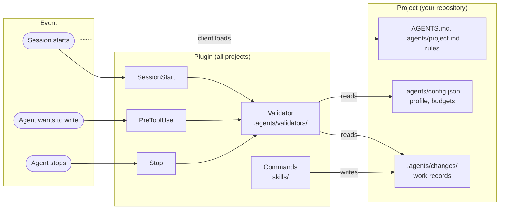

# Agents Kit

[](https://github.com/alprclbi/agents-kit/actions/workflows/validation.yml)
[](https://github.com/alprclbi/agents-kit/tags)
[](LICENSE)

A kit that gives your coding agent rules and keeps a record of the work it does.
Works with Claude Code and Codex.

Language: [Türkçe](README.md) · English.

> **Note on language.** This page is a translation. The rules the kit installs
> into your project (`AGENTS.md`, playbooks, skills) and the messages its hooks
> print are in Turkish today. Agents read them fine; you may want a translator
> at hand for hook messages. The [policy codes](docs/politika-kodlari.md) page
> lists every message code.

---

## Why?

Three things keep getting lost when you work with an agent:

- **Context is gone when the session ends.** The next day you explain "where were we" from scratch.
- **Rules get rewritten in every project.** You copy the same instructions again and again.
- **The agent forgets what it did.** Which file it touched and why is never recorded.

The kit fixes all three: you write the rules once, the work is saved to disk,
and hooks check whether the agent follows the rules.

---

## Installation

Two steps. No clone, no changing directories.

### Claude Code

In a terminal:

```bash
claude plugin marketplace add alprclbi/agents-kit
```

```bash
claude plugin install agents-kit@agents-kit
```

Inside Claude Code (terminal or desktop app) you can do the same with slash
commands:

```text
/plugin marketplace add alprclbi/agents-kit
/plugin install agents-kit@agents-kit
```

> In the desktop app `/plugin` opens an interactive panel. If the panel does not
> open, run the `claude plugin ...` commands above from a terminal; the result is
> the same.

Restart Claude Code after installing.

### Codex

```bash
codex plugin marketplace add alprclbi/agents-kit
```

```bash
codex plugin add agents-kit@agents-kit
```

You can also install from the interactive browser by typing `/plugins` in the
Codex CLI.

For the hooks, open `/hooks`, review the three hooks and their commands, and make
the trust decision yourself. The kit does not change any setting on your behalf.

### Installation scope

If Claude Code asks, choose the **user** scope; the tools are installed once and
apply to all your projects.

Codex has no scope flag.

### Installing is not activating

When the plugin is installed in user scope, the tools become **available** in
every project; the rules and hooks do not **switch on** in any project by
themselves.

The kit runs only in a project that has a `.agents/config.json` file. Without
that file the three hooks pass without any output: no line at session start, no
checks on tool calls, nothing at the close.

To activate it in a project, run `/agents-kit:init` there. To deactivate it,
`/agents-kit:remove-kit`; you do not need to uninstall the plugin.

| Situation | Result |
| --- | --- |
| Plugin installed, no `.agents/` in the project | Skills visible, hooks silent |
| Plugin installed, `/agents-kit:init` run in the project | Rules and hooks active |

---

## First use

After installing, open any project and tell the agent:

```text
/agents-kit:init
```

The agent asks at most two questions:

| Question | What it means |
| --- | --- |
| Solo or team? | Rules are strict in a team, warnings only when solo |
| Existing `AGENTS.md` found | Keep your rules, or bring in the kit core |

It backs up every file it touches first. It does not touch your own instructions
in `CLAUDE.md`.

---

## Commands

All are called with the `/agents-kit:` prefix. The prefix is the client's
collision guard.

### Daily use

| Command | When |
| --- | --- |
| `start-work` | Starting new work. Feature, bug, refactor: all the same |
| `resume-work` | Coming back to work left in another session. Removes "where were we" |
| `checkpoint-work` | Mid-work save. Prevents context loss on long tasks |
| `close-work` | Work is done. Closes it with evidence for the acceptance criteria |
| `archive-work` | Moves closed work from the active list to the archive |

The [example work](docs/ornek-is.md) page (Turkish) shows what these five steps
leave on disk.

### Setup and maintenance

| Command | When |
| --- | --- |
| `init` | Installs the kit into a project. Migrates an old installation itself |
| `update` | Brings the project's rules up to the plugin version |
| `kit-doctor` | Something looks wrong. Changes nothing, only reports |
| `remove-kit` | Removes the kit. Does not touch what you wrote |

### Runs in the background

| Command | What it does |
| --- | --- |
| `artifact-router` | Resolves where spec, plan and task files are written. You rarely call it |

---

## Updating

Two separate things are updated, and they work differently.

### Tools: one command, all projects

```bash
claude plugin update agents-kit@agents-kit
```

In Codex:

```bash
codex plugin marketplace upgrade agents-kit
```

No matter how many projects use it, all are updated at once. You touch no
project. Restart the client afterwards.

### Rules: project by project

Rules live inside the project, so they are updated per project. If they are
behind, you see one line at session start:

```text
Iskele: 1.0.0 (plugin 1.1.0)
```

Tell the agent:

```text
/agents-kit:update
```

It asks nothing and reports what it did in five lines. To see what would change
first, say `/agents-kit:update önizle`: it shows in a table which files would be
written, backed up or skipped, and writes nothing.

**It never touches three places:**

| Place | What is inside |
| --- | --- |
| `.agents/project.md` | Your project rules |
| `.agents/local/` | Your personal preferences |
| `.agents/changes/` | Your work records |

Your own instructions in `CLAUDE.md` are kept too. If you edited a kit file by
hand, it is backed up before being overwritten.

---

## Removal

```text
/agents-kit:remove-kit
```

It deletes only the kit's own files and **asks for confirmation before
deleting**. Your work records, project rules and hand-edited files stay.

To remove the plugin as well:

```bash
claude plugin uninstall agents-kit@agents-kit
```

In Codex:

```bash
codex plugin remove agents-kit@agents-kit
```

---

## What goes where

| What | Where it lives | Who updates it |
| --- | --- | --- |
| Tools (commands, checks) | Plugin, all projects | One command, all at once |
| Rules (`AGENTS.md`, `.agents/`) | Inside the project | When you approve |

Written into your project: `AGENTS.md`, `CLAUDE.md`, `AGENT-KIT-START.md`,
`.agents/`, `.claude/`, `.codex/`.

Belonging to the kit's own repository and **not installed into your project**:
`README.md`, `README.en.md`, `LICENSE`, `CONTRIBUTING.md`, `SECURITY.md`,
`CHANGELOG.md`, `.github/`, `docs/`, `.agents/tests/`, `.agents/evals/`.

---

## How it works

The kit has two layers. The plugin layer carries the commands and the checks;
the project layer carries the rules and the work records. Checks run through
three hooks, and all of them call the same validator.



| Hook | When | What it checks | Result |
| --- | --- | --- | --- |
| `SessionStart` | Session start, resume, context compaction | Profile, active work, rule version | Gives the agent a short status block |
| `PreToolUse` | Before the agent writes a file or runs a shell command or MCP tool | Active work record, ownership conflicts | `team` blocks; `solo` warns only on ownership conflicts. Read-only commands and read-only MCP tools always pass |
| `Stop` | When the agent finishes its answer | Specs and plans written outside the canonical path; an active work's `status.md` older than the latest change | Stray path: `solo` warns, `team` blocks the close; stale `status.md` only warns in every profile |

Hooks never reach the network and never write files; they only read and decide.
In a project without `.agents/config.json` they pass without printing anything.

---

## If something goes wrong

Run this first:

```text
/agents-kit:kit-doctor
```

It changes nothing; it only reports the state.

| Symptom | Cause | What to do |
| --- | --- | --- |
| Commands do not show up | Client was not restarted | Close and reopen Claude Code |
| Nothing happens in the project | The kit is not set up in that project | `/agents-kit:init`; installing the plugin is not enough |
| An `Iskele: ... (plugin ...)` line | Rules are behind | `/agents-kit:update` |
| `AKE203` block (`team`) | No active work record | `/agents-kit:start-work`; the `solo` profile has no such check |
| Manifest error | A kit file was edited by hand | `/agents-kit:update`; your change is backed up |

For any other `AK` code, see the [policy codes](docs/politika-kodlari.md) page
(Turkish) for its meaning, severity per profile and fix.

---

## Requirements

| Environment | Needed |
| --- | --- |
| Linux, macOS | `git`, `jq`, `sha256sum` |
| Windows | Git for Windows (Git Bash) |
| Windows without Git Bash | PowerShell 5.1+; see [AGENT-KIT-START.md](AGENT-KIT-START.md) |

---

## Network and privacy

**The kit's own code never reaches the network.** Commands and checks make no
requests and send no data.

The client downloads the plugin package: Claude Code or Codex, through its own
marketplace mechanism.

The kit never creates commits, pushes, PRs or issues on its own.

---

## Installing without the plugin

Scripts are available for offline environments or CI:

```bash
git clone --depth 1 https://github.com/alprclbi/agents-kit /tmp/agents-kit
cd /your/project
sh /tmp/agents-kit/install.sh
```

On Windows, `install.ps1`.

---

## More

| Topic | File |
| --- | --- |
| What one piece of work leaves on disk | [docs/ornek-is.md](docs/ornek-is.md) (Turkish) |
| Policy codes (`AKE203` etc.) | [docs/politika-kodlari.md](docs/politika-kodlari.md) (Turkish) |
| Release history | [CHANGELOG.md](CHANGELOG.md) (Turkish) |
| Contributing | [CONTRIBUTING.md](CONTRIBUTING.md) (Turkish) |
| Reporting security issues | [SECURITY.md](SECURITY.md) (Turkish) |
| Installation details and Windows notes | [AGENT-KIT-START.md](AGENT-KIT-START.md) (Turkish) |

License: MIT; see [LICENSE](LICENSE).
