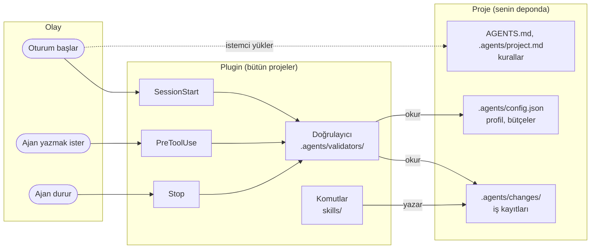

# Agents Kit

[](https://github.com/alprclbi/agents-kit/actions/workflows/validation.yml)
[](https://github.com/alprclbi/agents-kit/tags)
[](LICENSE)

Kodlama ajanına kural veren ve yaptığı işi kayıt altına alan bir kit.
Claude Code ve Codex ile çalışır.

Dil: Türkçe · [English](README.en.md).

---

## Neden?

Ajanla çalışırken üç şey sürekli kaybolur:

- **Oturum kapanınca bağlam gider.** Ertesi gün "nerede kalmıştık" diye baştan anlatırsın.
- **Kurallar her projede yeniden yazılır.** Aynı talimatları defalarca kopyalarsın.
- **Ajan ne yaptığını unutur.** Hangi dosyaya neden dokunduğu kayıtsız kalır.

Kit bu üçünü çözer: kuralları bir kez yazar, işi diske kaydeder, ajanın kurallara
uyup uymadığını denetler.

---

## Kurulum

İki adım. Klon yok, dizin değiştirme yok.

### Claude Code

Terminalde:

```bash
claude plugin marketplace add alprclbi/agents-kit
```

```bash
claude plugin install agents-kit@agents-kit
```

Claude Code'un içindeyken (terminal veya masaüstü uygulaması) aynı işi slash
komutuyla da yapabilirsin:

```text
/plugin marketplace add alprclbi/agents-kit
/plugin install agents-kit@agents-kit
```

> Masaüstü uygulamasında `/plugin` etkileşimli bir panel açar. Panel açılmıyorsa
> yukarıdaki `claude plugin ...` komutlarını terminalden çalıştır; sonuç aynıdır.

Kurulumdan sonra Claude Code'u yeniden başlat.

### Codex

```bash
codex plugin marketplace add alprclbi/agents-kit
```

```bash
codex plugin add agents-kit@agents-kit
```

Codex CLI içinde `/plugins` yazarak etkileşimli tarayıcıdan da kurabilirsin.

Hook'lar için `/hooks` komutunu aç, üç hook'u ve komutlarını incele, güven
kararını sen ver. Kit senin adına hiçbir ayarı değiştirmez.

### Kurulum kapsamı

Claude Code sorarsa **kullanıcı** kapsamını seç; araçlar bir kez kurulur, bütün
projelerinde geçerli olur.

Codex'te kapsam bayrağı yoktur.

### Kurmak, aktif etmek değildir

Plugin kullanıcı kapsamında kurulduğunda araçlar her projede **erişilebilir**
olur; kurallar ve hook'lar hiçbir projede kendiliğinden **devreye girmez**.

Kit yalnız `.agents/config.json` dosyasının bulunduğu projede çalışır. O dosya
yoksa üç hook da hiçbir çıktı vermeden geçer: oturum başında satır basmaz,
araç çağrılarını denetlemez, kapanışta konuşmaz.

Bir projede aktif etmek için orada `/agents-kit:init` çalıştır. Kaldırmak için
`/agents-kit:remove-kit`; plugin'i kaldırmak gerekmez.

| Durum | Sonuç |
| --- | --- |
| Plugin kurulu, projede `.agents/` yok | Skill'ler görünür, hook'lar sessiz |
| Plugin kurulu, projede `/agents-kit:init` çalıştırılmış | Kurallar ve hook'lar etkin |

---

## İlk kullanım

Kurulumdan sonra herhangi bir projeyi aç ve ajana şunu yaz:

```text
/agents-kit:init
```

Ajan en fazla iki soru sorar:

| Soru | Ne demek |
| --- | --- |
| Yalnız mı, ekiple mi? | Ekipte kurallar sıkı, tek başına uyarı düzeyinde |
| Mevcut `AGENTS.md` var | Kuralların korunsun mu, kit çekirdeği mi gelsin |

Dokunduğu her dosyayı önce yedekler. Varsa `CLAUDE.md` içindeki kendi
talimatlarına dokunmaz.

---

## Komutlar

Hepsi `/agents-kit:` ön ekiyle çağrılır. Ön ek istemcinin çakışma önlemi.

### Günlük kullanım

| Komut | Ne zaman |
| --- | --- |
| `start-work` | Yeni bir işe başlarken. Özellik, hata, refactor — fark etmez |
| `resume-work` | Başka oturumda kalınan işe dönerken. "Nerede kalmıştık" sorusunu kaldırır |
| `checkpoint-work` | İş yarıdayken ara kayıt. Uzun işlerde bağlam kaybını önler |
| `close-work` | İş bitti. Kabul ölçütlerini kanıtla kapatır |
| `archive-work` | Kapanan işi aktif listeden arşive taşır |

Bir işin bu beş adımda diske ne bıraktığını [örnek iş](docs/ornek-is.md) sayfası
gösterir.

### Kurulum ve bakım

| Komut | Ne zaman |
| --- | --- |
| `init` | Kiti projeye kurar. Eski kurulum varsa göçü kendi yapar |
| `update` | Projedeki kuralları plugin sürümüne çeker |
| `kit-doctor` | Bir şey ters gidiyorsa. Hiçbir şeyi değiştirmez, sadece bakar |
| `remove-kit` | Kiti kaldırır. Senin yazdıklarına dokunmaz |

### Arka planda çalışan

| Komut | Ne yapar |
| --- | --- |
| `artifact-router` | Spec, plan ve görev dosyalarının nereye yazılacağını çözer. Genelde sen çağırmazsın |

---

## Güncelleme

İki ayrı şey güncellenir ve ikisi farklı çalışır.

### Araçlar — tek komut, bütün projeler

```bash
claude plugin update agents-kit@agents-kit
```

Codex'te:

```bash
codex plugin marketplace upgrade agents-kit
```

Kaç projede kullandığın fark etmez; hepsi aynı anda güncellenir. Hiçbir projeye
dokunmazsın. Sonra istemciyi yeniden başlat.

### Kurallar — proje proje

Kurallar projenin içinde durur, o yüzden proje başına güncellenir. Geride
kaldıysa oturum başında tek satır görürsün:

```text
Iskele: 1.0.0 (plugin 1.1.0)
```

Ajana şunu de:

```text
/agents-kit:update
```

Soru sormaz, beş satırda ne yaptığını söyler. Önce neyin değişeceğini görmek
istersen `/agents-kit:update önizle` de: hangi dosyanın yazılacağını,
yedekleneceğini veya atlanacağını tabloyla gösterir, hiçbir şey yazmaz.

**Üç yere hiçbir koşulda dokunmaz:**

| Yer | İçinde ne var |
| --- | --- |
| `.agents/project.md` | Senin proje kuralların |
| `.agents/local/` | Kişisel tercihlerin |
| `.agents/changes/` | İş kayıtların |

`CLAUDE.md` içindeki kendi talimatların da korunur. Bir kit dosyasını elle
değiştirdiysen üzerine yazmadan önce yedeklenir.

---

## Kaldırma

```text
/agents-kit:remove-kit
```

Yalnız kitin kendi dosyalarını siler ve **silmeden önce onay ister**. İş
kayıtların, proje kuralların ve elle değiştirdiğin dosyalar kalır.

Plugin'i de kaldırmak istersen:

```bash
claude plugin uninstall agents-kit@agents-kit
```

Codex'te:

```bash
codex plugin remove agents-kit@agents-kit
```

---

## Nereye ne kurulur

| Ne | Nerede durur | Kim günceller |
| --- | --- | --- |
| Araçlar (komutlar, denetim) | Plugin — bütün projeler | Tek komut, hepsi birden |
| Kurallar (`AGENTS.md`, `.agents/`) | Projenin içinde | Sen onaylayınca |

Projene yazılanlar: `AGENTS.md`, `CLAUDE.md`, `AGENT-KIT-START.md`, `.agents/`,
`.claude/`, `.codex/`.

Kitin kendi deposuna ait olan ve **projene kurulmayanlar**: `README.md`,
`README.en.md`, `LICENSE`, `CONTRIBUTING.md`, `SECURITY.md`, `CHANGELOG.md`,
`.github/`, `docs/`, `.agents/tests/`, `.agents/evals/`.

---

## Nasıl çalışır

Kit iki katmandan oluşur. Plugin katmanı komutları ve denetimi taşır; proje
katmanı kuralları ve iş kayıtlarını. Denetim üç hook ile yapılır ve hepsi aynı
doğrulayıcıyı çağırır.



| Hook | Ne zaman | Neye bakar | Sonuç |
| --- | --- | --- | --- |
| `SessionStart` | Oturum açılınca, devam edince, bağlam sıkıştırılınca | Profil, aktif iş, kural sürümü | Ajana kısa bir durum bloğu verir |
| `PreToolUse` | Ajan dosya yazmadan, kabuk komutu veya MCP aracı çalıştırmadan önce | Aktif iş kaydı, sahiplik çakışması | `team` engeller; `solo` yalnız sahiplik çakışmasında uyarır. Salt okunur komutlar ve okuma MCP araçları hep geçer |
| `Stop` | Ajan cevabını bitirince | Kanonik yol dışına yazılmış spec ve planlar; aktif işte `status.md` son değişiklikten eskiyse | Kaçak yolda `solo` uyarır, `team` kapanışı engeller; eski `status.md` her profilde yalnız uyarır |

Hook'lar ağa çıkmaz ve dosya yazmaz; yalnız okur ve karar verir. `.agents/config.json`
olmayan projede hiçbir şey basmadan geçerler. Basılan
kodların anlamı [Politika kodları](docs/politika-kodlari.md) sayfasında.

---

## Bir şey ters giderse

Önce şunu çalıştır:

```text
/agents-kit:kit-doctor
```

Hiçbir şeyi değiştirmez, sadece durumu söyler.

| Belirti | Sebebi | Ne yapmalı |
| --- | --- | --- |
| Komutlar görünmüyor | İstemci yeniden başlatılmadı | Claude Code'u kapat aç |
| Projede hiçbir şey olmuyor | Kit o projede kurulu değil | `/agents-kit:init` — plugin kurulumu yetmez |
| `Iskele: ... (plugin ...)` satırı | Kurallar geride kaldı | `/agents-kit:update` |
| `AKE203` engeli (`team`) | Aktif iş kaydı yok | `/agents-kit:start-work`; `solo` profilde bu kontrol yok |
| Manifest hatası | Bir kit dosyası elle değişti | `/agents-kit:update` — değişikliğin yedeklenir |

Başka bir `AK` kodu gördüysen anlamı, profil başına şiddeti ve çözümü
[Politika kodları](docs/politika-kodlari.md) sayfasında.

---

## Gereksinimler

| Ortam | Gereken |
| --- | --- |
| Linux, macOS | `git`, `jq`, `sha256sum` |
| Windows | Git for Windows (Git Bash) |
| Windows, Git Bash yok | PowerShell 5.1+ — bkz. [AGENT-KIT-START.md](AGENT-KIT-START.md) |

---

## Ağ ve gizlilik

**Kitin kendi kodu ağa çıkmaz.** Komutlar ve denetimler hiçbir istek yapmaz,
hiçbir veri göndermez.

Plugin paketini indiren istemcidir — Claude Code veya Codex, kendi marketplace
mekanizmasıyla.

Kit kendi başına commit, push, PR veya issue oluşturmaz.

---

## Plugin kullanmadan kurmak

Ağa kapalı ortam veya CI için betikler duruyor:

```bash
git clone --depth 1 https://github.com/alprclbi/agents-kit /tmp/agents-kit
cd /senin/projen
sh /tmp/agents-kit/install.sh
```

Windows'ta `install.ps1`.

---

## Daha fazlası

| Konu | Dosya |
| --- | --- |
| Bir işin baştan sona diske bıraktıkları | [docs/ornek-is.md](docs/ornek-is.md) |
| Politika kodları (`AKE203` vb.) | [docs/politika-kodlari.md](docs/politika-kodlari.md) |
| Sürüm geçmişi | [CHANGELOG.md](CHANGELOG.md) |
| Katkı rehberi | [CONTRIBUTING.md](CONTRIBUTING.md) |
| Güvenlik bildirimi | [SECURITY.md](SECURITY.md) |
| Kurulum ayrıntısı ve Windows notları | [AGENT-KIT-START.md](AGENT-KIT-START.md) |

Lisans: MIT — bkz. [LICENSE](LICENSE).
